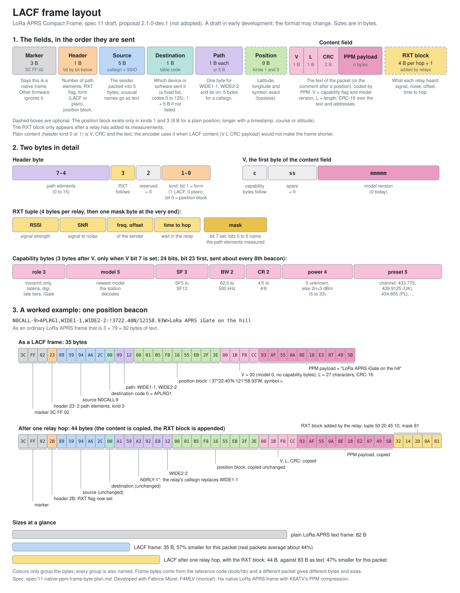

# APRS-PPM: LoRa APRS packets about 40% smaller

> **LACF 2.0.0 (2 November 2026): protocol version 2. It is not compatible with the earlier test builds (1 and 2 November).**
> Plain-form frames now carry a CRC-16 (a plain frame cut before transmission used to be accepted as different text), the
> plain or LACF form is in the header kind bits, and the version byte `V` is now the protocol version (5 bits) and the table
> version (3 bits). A version 2 station and an earlier test build drop each other's LACF frames; plain APRS text is unaffected.
> **Update every device that sends or receives LACF together:** the iGate, the tracker and the Raspberry Pi running Dire Wolf.
> Version 2.0.0 was run on the air on 2 November 2026 between a LoRa32 iGate, a T-Deck Plus and a Dire Wolf hill station, with no
> frame dropped. See the [changelog](CHANGELOG.md), [spec 11](spec/11-native-ppm-frame-byte-plan.md) (version 2.0.0, tag
> [`v2.0.0`](https://github.com/radiohound/aprs-compression-proposal/tree/v2.0.0)) and the
> [firmware page](https://tiles.aivu.com/lacf), where the version is on every download button.

> **WORK IN PROGRESS: the direction has changed.** The first common LoRa APRS format is being worked out together with Fabrice Morel, F4MLV (moricef) in [issue 7 of moricef/LoRa_APRS_Tracker](https://github.com/moricef/LoRa_APRS_Tracker/issues/7): his native frame with the content coded by PPM (hybrid B), named **LACF**, the LoRa APRS Compact Frame, so a relay can rewrite the path and add an RXT measurement without decompressing anything.
> The byte plan is [spec 11](spec/11-native-ppm-frame-byte-plan.md), a **draft** in early development and still being reviewed for change, implemented in test branches of the iGate, the T-Deck tracker and Dire Wolf, and tried on the air on 1 November 2026. **The whole-packet figures below (about half the bytes) describe the earlier standalone format, which is not the plan.** The older frames (`3C FF 81`, `3C FF C1`) described here still work as documented, and remain the only ones in released firmware.

> **Breaking change, 26 October 2026: upgrade if you built an earlier version.** After an independent tester showed that a
> primed frame (`3C FF C1`) could decode to the wrong text when a receiver held a stale reference, the primed header gained
> a check byte over the whole text (now 7 bytes, was 6). **Builds from before this change are not compatible with builds
> from after it for primed frames:** each side almost always drops the other's primed frames, and about 1 in 256 could decode
> to the wrong text, the same weakness the new byte removes. Full frames (`3C FF 81`) and plain frames are unchanged and
> still work between old and new. **Rebuild and reflash every device that uses this code, all together.** Receivers must also
> drop any `3C FF` frame of a type they do not know, and not pass it on as text. Primed frames are one byte
> bigger, so primed savings are about 2 points lower than quoted before this change.
> Details and the test results: [known issues](docs/known-issues.md).

**The same APRS packet, sent in about 40% fewer bytes (35 to 44% depending on the network, and 38% on one network after a relay hop with the relay's signal data added; the earlier whole-text format saved 40 to 50%), and turned back into the identical text at the other end.**
It extends APRS and does not replace it: stations that don't know about it carry on exactly as before.

> An idea that is showing promise and needs more testing. The earlier whole-text format was tried on three kinds of hardware over two links, and
> LACF (spec 11) has been run on an iGate, a T-Deck and a Dire Wolf station; both were replayed on tens of thousands of captured packets. What is proven and what is not is listed
> [below](#what-this-does-not-show-yet).

## Why

A LoRa APRS packet is ordinary text, 40 to 100 bytes, sent very slowly on a channel everyone shares. At spreading
factor 12 a 57-byte beacon holds the channel for about 2.6 seconds. Fewer bytes means less time on the air, fewer
collisions, more stations on one channel, and longer battery life on a tracker.

## The idea

APRS text is very repetitive. Nearly every packet carries the same repeater path (`WIDE1-1`), the destination field names the
software (`APLRT1` for a LoRa tracker), a station repeats its own comment and symbol in every beacon, and the digits of a
position barely change from one beacon to the next. Sender and receiver share a small fixed table of "what usually comes next", so the
likely characters cost almost nothing and only the surprises cost bits. Nothing is learned on the air, and the table
ships with the software. The method is called **PPM**, *prediction by partial matching*, a text-compression technique
from 1984 (Cleary and Witten) whose PPMd variant is a standard method in 7-Zip and RAR archives. Here, each character is
predicted from the three before it.

### The current format: LACF (spec 11)

LACF, the *LoRa APRS Compact Frame*, is the native LoRa APRS frame (`3C FF 02`) with a PPM-coded **content field**: the addresses and path are packed into a few bytes,
and only the text of the packet (or the comment after a position) is compressed, with a CRC-16 over the text, kind bits, `V`, source and destination (the mutable path is excluded) so a damaged or cut frame is dropped, not
mis-read. A relay adds an optional **RXT block** (what each hop heard: signal strength, signal-to-noise, frequency offset, time to hop) at the end without touching the content. Stations that do not
know the frame ignore it. The byte plan is [spec 11](spec/11-native-ppm-frame-byte-plan.md), a draft.



The picture is explained field by field, with the example byte by byte, in [docs/lacf-frame-layout.md](docs/lacf-frame-layout.md). Measured on 14,305 real packets
([docs/hybrid-savings-and-timing.md](docs/hybrid-savings-and-timing.md)):

| What is compared | Plain | LACF | Bytes saved | Airtime saved, SF7 / SF12 |
|---|---|---|---|---|
| As the origin sends it, no RXT (14,305 packets) | 86.6 B | 48.7 B | **43.8%** | 36.3% / 35.0% |
| After one relay hop, compression alone (RXT left out on both sides, 4,368 packets) | 84.8 B | 47.8 B | 43.7% | 36.4% / 34.9% |
| After one relay hop, LACF with its RXT block against a plain packet without it | 84.8 B | 52.8 B | 37.8% | 31.2% / 30.2% |
| After one relay hop, like for like (the plain packet carries the same RXT data as text) | 91.8 B | 52.8 B | 42.5% | 35.6% / 34.3% |

The airtime saving is smaller than the byte saving because every LoRa frame pays a fixed preamble and header; relayed traffic lowers it further, because the frame
then carries the RXT data. On the air (1 November 2026, a LoRa32 iGate, a T-Deck tracker and a Dire Wolf hill station) beacons were 29 B against 50 B, 58 B against 89 B and
39 B against 57 B, and the LACF frames received were decoded to the exact text sent. The measurements are in [docs/lacf-test-results-2026-11-01.md](docs/lacf-test-results-2026-11-01.md).
These figures are from one network's packets and will differ elsewhere.

```
As the origin sends it (14,305 real packets):
plain  ███████████████████████████████████  86.6 B
LACF   ███████████████████                  48.7 B  43.8% smaller

After one relay hop (4,368 relayed packets); the LACF frame carries the relay's RXT data, the plain packet none:
plain  ██████████████████████████████████   84.8 B
LACF   █████████████████████                52.8 B  37.8% smaller
```

### The earlier whole-text format (superseded by LACF; the results below are for it)

**Removed from the test firmware on 2 November 2026:** the iGate and the T-Deck tracker no longer read or send these frames, because no station sends them; they are dropped like any other unknown `3C FF` type. LACF is the only compressed format there. See [the test results](docs/lacf-test-results-2026-11-01.md), section 7. The description and the results below are kept as history.

Two kinds of compressed frame:

* **Full frame** (`3C FF 81`): the whole packet, compressed. Anyone with the table can read it. About **40 to 50% smaller**: 41% on stations the table had never seen, 47% over the full-day radio test below.
* **Primed frame** (`3C FF C1`): coded against the same station's last full packet, so only what *changed* is sent.
  About **55 to 70% smaller**. A receiver that missed the reference drops it and recovers at the next full frame. A check byte over the whole packet
  (added after an independent tester's findings, see [known issues](docs/known-issues.md)) stops a wrong reference from decoding to the wrong text.
  The primed figures on this page were measured before that byte; each primed frame is now one byte larger.

A station sends a full frame at least every second packet by default (a stationary one can send them less often), so a lost
frame costs little. If compression would not save anything, the plain frame goes out instead.

## Results of the earlier whole-text format

These are the first results (24 to 25 October 2026), for the whole-text frames `3C FF 81` and `3C FF C1` described above. The LACF results are in the section above.

### On real radios (24 to 25 October 2026)

An ESP32 iGate, a LILYGO T-Deck tracker and a Raspberry Pi running Direwolf with an SX1262 LoRa HAT, 433.775 MHz,
SF12, 125 kHz. Details, with every frame, are in [docs/over-the-air-test.md](docs/over-the-air-test.md).

| Test | Result |
|---|---|
| ESP32 sends, Direwolf receives | **12 of 12** decoded exactly. An average-sized position beacon with a comment: **75 B plain, 38 B full, 14 B primed** |
| Direwolf sends, ESP32 receives | **5 of 5** exactly. The gateway's short station beacon: **57 B plain, 25 B full, 8 B primed** |
| T-Deck tracker sends, ESP32 receives | **6 of 6** exactly. A tracker beacon (40 B plain, no comment): full frames 42% smaller, primed frames **63 to 68% smaller** |
| Direwolf sends, T-Deck receives | **16 of 16** frames received; all 8 compressed ones expanded to exactly the text sent |
| T-Deck to a Direwolf iGate 2 miles away, every 15 minutes | Compressed beacon expanded and **passed to APRS-IS one second later as an ordinary packet**; nothing downstream needed to know |
| The same, for a full day (23 h 57 min, 80 beacons expanded of about 96 sent) | **51% fewer bytes on air** (1,736 B against 3,515 B). About 10 beacons were never heard, and 6 primed frames arrived but were dropped because their full frame was missed |

The tests used different packets, so compare plain with compressed within a row, not between rows: a shorter packet is smaller in every
format, whichever device sends it.

Airtime at SF12, from the LoRa airtime formula (not measured on air): the 57-byte beacon takes **2.6 s plain,
1.5 s as a full frame and 1.0 s as a primed frame**. The preamble does not shrink, so time saved is a little less
than bytes saved.

### On 1,037 live packets (replayed, 24 October 2026; the earlier whole-text format, not LACF)

Fresh LoRa APRS-IS traffic captured read-only after both formats were built. Each packet is compressed and the
result decoded back; the average size is what is on the air.

```
plain                    ███████████████████████████████████ 70.7 B
APRS-PPM, one frame      █████████████████ 33.2 B            53% smaller
APRS-PPM, full + primed  ████████████████ 32.1 B             55% smaller
```

### On bigger sets

| Packets | Plain | Native frame | APRS-PPM, one frame | APRS-PPM, full + primed |
|---|---|---|---|---|
| 27,276 LoRa, a three-hour capture | 69.2 B | 50.4 B (27%) | 32.1 B (54%) | 24.4 B (65%) |
| 1,090 Mic-E packets, VHF | 61.1 B | 44.5 B (27%) | 49.7 B (19%) | 40.7 B (33%) |

92% of these 1,037 packets come from stations that were in the captures the table was trained on. The 87 from stations
it had never seen came out **44% smaller** as one full frame and 47% with priming, in line with the 41% held-out figure below.

The table was trained on 70% of the stations in a separate three-hour capture and tested on the other 30%, so the
earlier study's figures are on stations it had never seen: **41% fewer bytes** per frame without priming, and about
**55%** with a full frame every second packet ([docs/per-country-estimate.md](docs/per-country-estimate.md)).
On compact VHF Mic-E packets the saving is smaller; that is reported as is.

The "native frame" column is a community draft (draft 0), a binary layout for LoRa APRS with typed fields, packed callsigns and optional
receiver data. Its aims go beyond size, so it is shown as a yardstick, one packet at a time, and not as a rival: on Mic-E,
which is already compact, it is a little smaller than one APRS-PPM frame. The two are not exclusive, since its text part uses a
fixed code that this model could in principle replace (not tried). The comparison and its limits are in
[docs/alternatives-considered.md](docs/alternatives-considered.md).

## What this does not show yet

* **LACF is newer and less tested.** It has run on a LoRa32 iGate, a T-Deck and a Dire Wolf hill station, a few metres apart and on one hill link. Not yet tried: a relay chain on the air,
  RXT through a real relay, a digipeater that forwards LACF frames, other boards, other spreading factors, long runs. The figures above come from replaying captured packets and from short
  on-air runs.
* **Needs more testing (earlier format).** So far two links and three kinds of hardware: a LILYGO LoRa32 V2.1 (ESP32), a LILYGO T-Deck and a
  Raspberry Pi LoRa HAT running a branch of Direwolf. The longer link is about 2 miles, signal around -95 to -98 dBm at the
  gateway, one night, mild weather. Not yet tried: a busy channel, a really weak signal, other spreading factors, a stock
  iGate or tracker meeting a compressed frame.
* **Receivers without the code can't read compressed frames.** They hear and ignore them, so transmit is off by
  default and meant for places where every receiver that matters has the code. A compressed frame that an iGate
  with the code hears reaches APRS-IS as a normal packet.
* **One table for everyone.** It was trained on traffic from about 25 countries in proportion to their share of LoRa
  APRS, and the saving is similar across them: most countries land between about 35% and 47%, the US at 43%
  ([docs/per-country-estimate.md](docs/per-country-estimate.md)). The raw captures hold real callsigns and positions
  and are not published, only the aggregates.

## What exists

| Where | What |
|---|---|
| [LACF test firmware page](https://tiles.aivu.com/lacf) | Browser flasher for the LoRa32 iGate and the T-Deck Plus, with the settings and warnings. Sources: iGate [`feature/lacf`](https://github.com/radiohound/LoRa_APRS_iGate-1/tree/feature/lacf), tracker [`hybrid`](https://github.com/radiohound/LoRa_APRS_Tracker-moricef/tree/hybrid), Dire Wolf [`feature/lora-hybrid`](https://github.com/radiohound/direwolf/tree/feature/lora-hybrid) |
| *Earlier whole-text format:* [ESP32 iGate firmware](https://github.com/radiohound/LoRa_APRS_iGate/tree/feature/order3-compression) | Receive always on, transmit opt-in |
| [Direwolf, LoRa HAT channel](https://github.com/radiohound/direwolf/tree/feature/lora-compression) | Receive always on, transmit opt-in; an iGate that expands compressed frames and gates them as normal packets |
| [T-Deck tracker firmware](https://github.com/radiohound/LoRa_APRS_Tracker-moricef/tree/ppm-compression) | Receive always on, transmit opt-in |
| [`spec/`](spec) and [`reference/`](reference) | The specifications, a plain-C codec, the frozen table and 129 worked examples (test vectors) for the earlier format; the LACF reference code is in [`tools/hb`](tools/hb) with 554 encode, 503 relay and 38 rejection vectors in [`test/`](test) |

These are shared so people can try the idea, not as a request. No pull request will be opened unless a maintainer says
one would be welcome. They are not part of the Direwolf LoRa driver pull request (#638).

## Read more

* [What a LACF frame looks like](docs/lacf-frame-layout.md): a picture and a byte-by-byte example
* [LACF byte and bit reference](docs/lacf-byte-reference.md): what every byte and bit of the frame means
* [Known issues and findings from testing](docs/known-issues.md): what other testers found, and what was fixed
* [Spec 11, the byte plan for the first common format (draft)](spec/11-native-ppm-frame-byte-plan.md): hybrid B, native frame with PPM content, RXT at the end; work in progress
* [Truncated payloads and integrity checks (work in progress)](docs/truncated-payloads-and-integrity.md): what a cut-short frame decodes to, the checks measured
* [LACF: airtime saved and processor time](docs/hybrid-savings-and-timing.md): measured on 14,305 real packets and on an ESP32, with the relayed-traffic effect
* [Questions and answers](docs/faq.md): does it still work on normal LoRa APRS, what reaches APRS-IS, what a stock iGate does
* [How it works, in plain language](docs/how-it-works.md) and [why not 438 or an off-the-shelf compressor](docs/alternatives-considered.md)
* [The over-the-air test log](docs/over-the-air-test.md), with a section updated as the long run continues
* [Everything else: all specs, simulation tables, roadmap, VHF notes](DETAILS.md)

## Try it

    make test        # checks the reference codec against the test vectors (earlier format)
    make hb-test     # checks the LACF (spec 11) reference code, its vectors and the cross-check

To try the current format (LACF, spec 11) on real radios, there is test firmware for the LILYGO LoRa32 V2.1 iGate and the LILYGO T-Deck Plus 433 tracker
that you can flash from a browser, with the settings, the warnings and what has been tested: <https://tiles.aivu.com/lacf>. It is experimental. Receive is
always on, transmit is a setting you choose, and a station that sends LACF is not heard by stations running stock firmware. For a Raspberry Pi with a LoRa HAT,
the Dire Wolf branch is [`feature/lora-hybrid`](https://github.com/radiohound/direwolf/tree/feature/lora-hybrid) (install notes in its `scripts/hill-hybrid/README.txt`).
The results so far are in [docs/lacf-test-results-2026-11-01.md](docs/lacf-test-results-2026-11-01.md).

The earlier whole-text format has its own [safe-testing page](https://github.com/radiohound/LoRa_APRS_iGate/blob/feature/order3-compression/tools/aprs_compress/EXPERIMENT.md).
Questions, results and problems are welcome as issues here.

## Credits

* **Fabrice Morel, F4MLV (moricef):** co-developer of LACF. It combines his native LoRa APRS frame and code (draft 0) with the PPM compression, and the two are working on it together (issue 7 of moricef/LoRa_APRS_Tracker). His T-Deck tracker firmware is the base of the T-Deck test build.
* **Walter Dunckel, K6ATV:** the APRS-PPM compression and the PPM-coded content field of LACF.
* **Jon, N7UV:** RXT, the per-hop reception measurements, and its early adoption on the Arizona network.
* **Ricardo Guzman, CA2RXU:** the LoRa APRS iGate and Tracker firmware that the iGate test build is based on.

Credit says who did the work. It does not mean the people named have reviewed or endorsed this proposal, which is in early development.

Licensed under the [MIT License](LICENSE).
