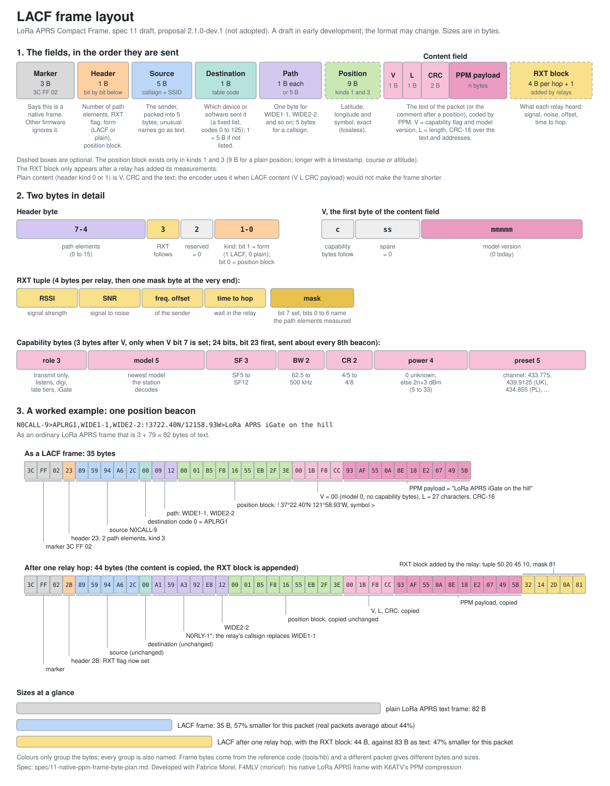

# LACF, the LoRa APRS Compact Frame: native frame with a PPM-coded content field (spec 11, byte plan)

> **DRAFT, WORK IN PROGRESS.** Not a standard; in early development and still being reviewed for change. It is implemented in the C reference, an independent Python implementation, the iGate, the T-Deck tracker and Dire Wolf (test branches), and was tried on the air on 1 November 2026 between a LoRa32, a T-Deck and a hill Pi; no released firmware has it. Details will change; do not build deployed software from this text. Where it is weak or undecided is listed under "Open" and "Not yet measured".
>
> *Last changed 2 November 2026. Version 2.0.0, see "Versions" below and `CHANGELOG.md`.*

| | |
|---|---|
| Version | **2.0.0** (protocol version 2, table version 0). Check this number against `VERSION` and `CHANGELOG.md` in the repository: if yours is lower, you are not up to date. See "Versions" |
| Name | **LACF**, the **LoRa APRS Compact Frame**: the native frame `3C FF 02` with a PPM-coded content field (called hybrid B in `tools/hybrid/`) |
| Status | **First draft of the byte plan F4MLV asked for in issue 7 of moricef/LoRa_APRS_Tracker (comments 14 to 17). Written by K6ATV and being reviewed. Implemented in the C reference (`tools/hb`), an independent Python implementation, the iGate (branch `feature/lacf`), the T-Deck tracker (branch `hybrid`) and Dire Wolf (branch `feature/lora-hybrid`); F4MLV's firmware does not implement it. The payload's integrity rules, the RXT tail and the receiver are tested (below).** |
| Credit | **Co-developed with Fabrice Morel, F4MLV (moricef).** LACF is a hybrid of his native LoRa APRS frame and code and K6ATV's PPM compression, and the two are working on it together (issue 7 of moricef/LoRa_APRS_Tracker). RXT was created by Jon, N7UV (see `tools/hybrid/README.md`, Credit) |
| Builds on | the native frame and code of Fabrice Morel, F4MLV (moricef) (see History at the end); hybrid B of `tools/hybrid/` and its tables (`tools/hybrid/tables/`); the PPM payload rules below (ending, CRC-16, re-encode check) |
| Replaces | nothing that was ever on the air. An earlier version of this repository used the name LACF for a standalone whole-text frame (spec 10, `3C FF 81`); that was never the plan and has been withdrawn, and the name now means this frame. PPM of the whole packet is **not** the plan: a relay would have to decompress, edit the path and recompress |

## What this is

This is **LACF** (hybrid B of `tools/hybrid/`): the native part (source, destination, path, RXT) is structured so a relay can edit it; the PPM part is only the content, which a relay copies unchanged.
In the terms of the thread (issue 7, comments 5 to 17): hybrid B + destination table v2 + lossless position block, with the comment-only table when the position is in the native block. Relays update the path and append RXT without decompressing.

Agreed with F4MLV as the scope of the first experimental common format (comment 16, confirmed in 17): native source, destination and path; the versioned destination table; lossless positions; standalone PPM for the remaining content; extended callsigns and SSIDs, content and the link between each measurement and its relay preserved exactly; receivers drop any frame whose format, model or table version they do not know (append-only tables).
**Not in the first format:** primed mode (and so the 1-byte station id), rounded or packed positions (`PACKPOS`, an optional tracker setting later), WSPR-style callsigns, the capability beacon and the power/backhaul questions, Mic-E as a native position (Mic-E travels as text).

## Frame

    3C FF 02 | header | source | destination | path... | [position block] | content field | [RXT block]

A picture of the whole frame, with a worked example, is at the end of this section.

`3C FF 02`, the header byte, the address elements, the path and the position block are defined exactly in Conformance. The frame has two forms, **LACF** (PPM-coded content) and **plain** (the text itself), each with or without a native position block (the four kinds in the header), a destination table, a rule for when to use plain, and the RXT block at the end.

### Header byte

| Bits | Meaning |
|---|---|
| 7-4 | number of path elements, 0 to 15 |
| 3 | an RXT block ends the frame (it follows the content field) |
| 2 | reserved, must be 0 |
| 1 | the form: **1 = LACF** (PPM-coded content), **0 = plain** (the text itself, with a CRC) |
| 0 | **1 = a native position block follows the path** (the content is then only the comment that remains), 0 = no position block (the content is the whole information field) |

The kind is therefore two independent bits: **form** (bit 1: plain or LACF) and **position block** (bit 0). Kind 0 is plain without a position block, 1 plain with one, 2 LACF without one, 3 LACF with one. F4MLV proposed the kind values for exactly this (comment 6: which coder was used). A receiver that does not know a frame MUST drop it and never show it as text.

### Content field (every kind)

The **content field** is everything after the position block (kinds 1 and 3) or the path (kinds 0 and 2) up to the RXT block. Its words: the **text** is the information field (kinds 0 and 2) or the comment (kinds 1 and 3) as characters; the **payload** is the PPM-coded bytes of that text; the **body** is the payload (LACF content) or the text (plain content). The first byte of the content field is `V`, present in **every** frame:

    V = vvvvv ttt
    vvvvv   5 bits   protocol version (this document: 2). It names the frame layout and the rules of the content field (32 versions); a receiver that does not hold it drops the frame
    ttt     3 bits   table version (this document: 0). It names the destination list AND the pair of LACF tables, revised together (8 versions); a receiver that does not hold it drops the frame

Whether the content is LACF or plain is **not** in `V`: it is bit 1 of the kind in the header.

LACF content (kinds 2 and 3):

    V        1 byte
    L        1 byte    number of text bytes coded, 1..255
    CRC      2 bytes   CRC-16/X-25 (below), low byte first
    payload  n bytes   range coder bytes of spec 01, ending as in "PPM payload rules" below

Plain content (kinds 0 and 1):

    V        1 byte
    CRC      2 bytes   CRC-16/X-25 (below), low byte first, over the same input as for PPM content
    text     the text itself, up to the RXT block or the end of the frame (no `L`: its length is what remains)

It is used when LACF would not shrink the text. **Protocol version 2 added the CRC to plain content** (F4MLV's RF test of 2 November 2026 showed that a plain frame cut before transmission was accepted and relayed as different text, because nothing but the LoRa CRC, which is computed after the cut, protected it).

* Kinds 0 and 2 carry the whole information field. Kinds 1 and 3 follow a position block and carry only the comment that remains.
* **What the CRC covers** (LACF and plain content). The CRC input is, in this order: the byte `header & 0x07` (the kind bits and the reserved bit, so the form and the position-block bit are covered); the byte `V`; the source as TNC2 text; the byte `>` (0x3E); the destination as TNC2 text (decoded through the destination list); the byte `:` (0x3A); and the information field (the text after the first `:` of the TNC2 packet), rebuilt from the position block and the decoded text.
  It does not cover the path or the rest of the header (the path count and the RXT bit), which relays change. A relay that only rewrites the path and appends a tuple therefore never recomputes it, and a receiver holding the wrong destination list, or receiving a damaged source, destination or `V`, fails the CRC.
* The payload length is not sent; the receiver derives it (Receiver, step 3).

**Tables.** LACF kind 2 uses the *info-native* table and kind 3 the *comment-only* table, because a comment after a position looks different from a whole information field. The low three bits of `V` (the table version) name the pair and the destination list; they are revised together. Table versions are allocated by this spec, append-only, starting at 0:

| `ttt` | Info-native table | Comment-only table | Status |
|---|---|---|---|
| 0 | `tools/hybrid/tables/model_hybridB_info_native.c` (sha256 `440a1ec2...dc270`, 77 KB) | `tools/hybrid/tables/model_hybridB_comment.c` (sha256 `d1262b44...eaf5`, 75 KB) | experimental: trained on 70% of the stations of one APRS-IS capture (callsign-hash buckets 3 to 9), 174,170 and 105,092 packets |

The tables' own header says "model version 2", which they share with the whole-packet and hybrid A tables of the same build; that number does not identify a layout, which is why the table version in `V` is allocated here. A deployed first format needs a frozen set trained on all stations and on several networks' data
(`train_layout_model.py --base-counts`, see the harness README), with a new `ttt`. The experimental set above must not be treated as the final one.

### Fallback to plain text

The encoder uses LACF content only when it is shorter than plain content: `4 + n < 3 + L` bytes (LACF: `V`, `L`, CRC and payload; plain: `V`, CRC and the text). Otherwise it sends plain content (the kind with the form bit clear: 0 for 2, 1 for 3), so the frame still uses the destination list and the RXT rules.
**Decided 2 November 2026: plain is a form in the header** (kinds 0 and 1), not a coding inside `V`. The draft-0 frames that used kinds 0 and 1 had no `V` and no CRC, so a receiver of this plan drops them (the CRC cannot match). On our packets 15% of information fields do not shrink with the info-native table and 6% of comments with the comment-only table (about a third on the harness's data).
After a position block, an empty comment sends no text (kind 1, plain content with nothing after `V` and the CRC: 3 bytes). These rules are the harness's `PLAINTEXT=1`. Senders must follow the size rule, and a receiver drops PPM content the encoder would not have sent (Receiver, step 5), the same way it drops a payload that is not the canonical encoding; any receiver decodes every coding it holds.

### Destination (versioned table, two bits reserved)

The destination is coded in one byte, `ff iiiiii`:

* `ff`, the top **two bits, are reserved**. A sender sets them to 0 and a receiver ignores them, so a later version can give them a meaning (for example "this station decodes hybrid B" or "this station appends RXT") without changing the table or the frame.
  Whatever they come to mean describes the originating station, not a relay in the path.
* `iiiiii`, the low six bits, give 64 codes. **Codes 0 to 61 name the 62 most common destinations of that table version, in descending order of popularity** (code 0 is the most common), so the common ones are found first by a simple search. Code 62 is reserved (a receiver drops a frame that uses it); decided: it is kept reserved and not used as a 63rd destination. **Code 63 is the escape:** after it comes an address element (5 bytes for an ordinary destination, so 6 in all; this is also the cost of a Mic-E destination, whose characters are the position, carried as a 5-byte element).
* A destination that has no direct code is not in the table: it escapes. There are no patterns and no second tier of 2-byte codes. In both measured captures registry patterns almost never fired (0 packets of 8,062 in Ariège and 2 of 14,305 in ours).
* **Each table version fills the 62 destination codes, in order of popularity, with the destinations that are most common then,** and need not keep the codes of the version before; the version names the list. A destination used only once is never given a code.

**Table version 0** (`ttt = 0`) is the file [`tools/hybrid/tables/tocall_set1.txt`](../tools/hybrid/tables/tocall_set1.txt) (sha256 `0e076bfbe365edc040cc294b7b271495d6f2e3d76292be9cd3dae5c4e6bf7a35`): 62 destinations ranked on our packets plus the destinations reported from the French capture; `APU25N`, `BEACON` and other rare ones are not in it. It is experimental, like the tables.

Measured on our 14,305 real packets (73 distinct destinations): the 62 most common as direct codes cover 99.9% of packets (the first five, `APLRG1`, `APLRT1`, `APLWS2`, `APLG01`, `APLRFD`, cover 88.8%), a mean of 1.0038 bytes per packet, against 1.015 for the v2 list of the harness (85 exact entries, 28 patterns). That ranking is made on the same data it is tested on, so it is optimistic; a real list is ranked on training stations and checked on held-out ones.
The harness's v2 list ([`tools/hybrid/tables/tocall_table_v2.txt`](../tools/hybrid/tables/tocall_table_v2.txt), sha256 `e700581b...f59aff`, 85 exact destinations and 28 patterns) is the starting data, not the final list: its entries seen once or twice in the captures (`APU25N`, `BEACON`) would not earn a direct code, and the few `APL...` destinations seen here that it lacks (`APSTKI` 20 packets, `APLM2D` 6, `APLGMT` 5, `APLHT2` 4) would compete for the 62 codes.
Exact-entry coverage of the v2 list on the French capture (Ariège, 8,062 packets) is 85.1% with v1 and 97.3% with v2; on the Arizona sample (2,659 packets) 99.8% and 100%; Mic-E is 2.5% in Ariège and always escapes.

**The table version is the low three bits of `V`**, present in every frame, so a receiver always knows which list a code refers to and drops a frame whose table version it does not hold. The direct codes mean different destinations in different table versions.

### RXT block (header bit 3 set)

    tuple 1 | tuple 2 | ... | tuple k | mask          the last byte of the frame is the mask

* A tuple is 4 bytes: RSSI, SNR, frequency offset, time to hop, each the RXT character minus 33, so each byte is 0 to 89 (his encoder clamps every field to 90 values; SNR has 89 steps, 0 to 88).
* The mask has **bit 7 set** as a marker. Bit j (0 to 6) set means that path element j (0 is the first element after the destination) carries a measurement. Tuples are in ascending order of j. `k` is the number of mask bits 0 to 6 that are set.
* The block is `4k + 1` bytes. Bits at or above the path element count are not allowed. **Each tuple byte must not exceed its field's maximum** (RSSI 89, SNR 88, frequency offset 89, time to hop 89, from his encoder's clamping; a receiver drops a frame with a tuple outside them): a free check on the tuples, which random damage fails about 98% of the time.

The tuples have no check of their own beyond the LoRa CRC, which already covers the whole frame at the level of VHF APRS (about 1 in 65,536); a block CRC would be recomputed by every relay and so add nothing the LoRa CRC does not give per hop.
The marker makes the block safe against truncation: a tuple byte is never 0x80 or more, so after a cut inside the block the last byte can never be mistaken for a mask (tested below). It costs one path element: at most 7 elements can carry a tuple (mask bits 0 to 6), not 8.
This placement (end of frame, mask byte last) is K6ATV's proposal in issue 7 (comment 5): a relay appends without moving the content, whatever the content is, and the content (PPM payload or text) is never touched by RXT, which is already compact binary and would not shrink. The same placement applies to both kinds, so a relay needs one rule.

A relay builds its outgoing frame from the front: new header and path, then the position block and content (the content field) copied byte for byte, then the old tuples, its own tuple and the new mask. If there was no block it creates one (tuple, mask) and sets header bit 3.
A relayed frame grows by **5 bytes for the first relay** (4 for the tuple, 1 for the mask) and 4 for each further one.

### The frame as a picture

The picture shows the fields in order, the header byte and `V` bit by bit, the RXT tuple, and one real packet as a LACF frame (35 bytes, hex) and after one relay hop (44 bytes). The example's 57% saving is for that one packet; real packets average about 44% (see "Size"). The same content as tables, with the example byte by byte, is in [`docs/lacf-frame-layout.md`](../docs/lacf-frame-layout.md), and every byte and bit is defined in [`docs/lacf-byte-reference.md`](../docs/lacf-byte-reference.md); the bytes come from the reference code, and `python3 tools/lacf_diagram.py` redraws the picture.

## PPM payload rules (normative)

These apply to the `payload` of the content field. The model, the range coder and every probability are those of spec 01 with the table the kind and `V` select.

**Why.** A payload cut short before it is sent carries a valid LoRa CRC, because the sender computes the CRC after the cut, and a decoder that pads missing input with zeros turns the cut payload into plausible text.
Measured on 14,298 real full frames, the unmodified decoder accepted every frame cut by 1 to 6 bytes, with the right length and a wrong tail. The rules below make the end of the payload unambiguous and make the receiver prove that the payload is the one an encoder would have sent.

**Ending.** After the last text byte is encoded, the encoder holds `low` (up to 33 bits, with a carry pending in bit 32) and `range`. Then:

1. If `low >= 2^32`: add 1 to the payload so far (propagating the carry through the bytes already written) and set `low = low - 2^32`.
2. Let `hi = low + range - 1`.
3. For `nb = 1, 2, 3, 4` in turn: let `blk = 2^(8*(4-nb))` and `v = ceil(low / blk) * blk` (the first multiple of `blk` that is `>= low`). If `v + blk - 1 <= hi`, stop.
   (If a decoder reads `nb` bytes and then anything at all, the 32-bit value it sees is some number from `v` to `v + blk - 1`; the condition says that every such number lies inside `[low, hi]`.
   `nb = 0` can never succeed, because `range < 2^32`. Because `range >= 2^24` after the last normalisation, `nb` is in fact always 1 or 2; 3 and 4 are never reached.)
4. If `v >= 2^32`: add 1 to the payload so far and set `v = v - 2^32`.
5. Append the top `nb` bytes of `v` (most significant first).
6. **Do not strip trailing zero bytes.** A zero last byte is sent.

The result is the fewest bytes after which **any** following bytes decode to the same text (in all but rare binary texts: 1 in 23,709 adversarial binary texts ended one byte longer than needed, because the decoder clamps to the last symbol; correctness is unaffected, since every receiver compares against the same deterministic encoder). Spec 01's ending (the fewest bytes assuming zeros follow, then stripping zeros) is replaced for these frames; the new ending is on average 0.25 bytes longer.
The encoder is deterministic: the same text always gives the same bytes, and a second implementation MUST produce them exactly, because the receiver check depends on it.

**CRC-16.** CRC-16/X-25, the AX.25 frame check: polynomial 0x1021 reflected (0x8408), initial value 0xFFFF, final xor 0xFFFF; the CRC of the ASCII string `123456789` is 0x906E. It is sent low byte first.

**Receiver equivalence.** The receiver decodes `L` text bytes, checks the CRC-16, re-encodes the text with the rules above and requires the result to equal the payload exactly (same length, same bytes). Decoding and re-encoding use the same probabilities for the same character,
so a receiver MAY re-encode while it decodes (one pass over the model instead of two); it must give the same accept and drop answers as the two-pass form. The CRC is checked before the comparison, so a damaged frame is dropped as early as possible.

**Measured.** Cut frames: 0 wrongly accepted at every cut size (1 to 16 bytes), 13,731 to 14,293 per size, with and without a relay tail. Damage inside the payload after the LoRa CRC has passed (1, 2, 3 and 8 flipped bits, random payload): the re-encode check alone leaves 1 in 208 to 1 in 2,286,
the CRC-16 alone about 1 in 52,000 to 1 in 142,000, and the two together **0 of about 2.85 million**, which meets the 1 in 65,536 of the AX.25 frame check. Two independent implementations (C and Python, the second written from the rules alone) agree on all 14,305 real texts and on 11,996 damaged frames.
Details and the other results are in [`docs/truncated-payloads-and-integrity.md`](../docs/truncated-payloads-and-integrity.md).

## Receiver (normative)

1. Drop the frame unless it starts `3C FF 02` and header bit 2 is clear. Kind bit 1 gives the form (1 LACF, 0 plain), kind bit 0 the position block.
2. Parse the addresses, the path and the position block (kinds 1 and 3), with the layouts and the strict rules of Conformance. Then read `V`: drop the frame unless its protocol version (top five bits) is held (2) and its table version (low three bits) is held (0). Earlier test builds sent `V` as `cc vvvvvv` (`01`, `02`, `C1`, `C2`): protocol versions 0, 0, 24 and 24 are not held, so those frames are dropped.
3. If header bit 3 is set: the last byte is the mask. Drop the frame unless bit 7 is set, `k >= 1`, every set bit is below the path element count, and at least `4k + 1` bytes remain after the start of the content field's body, which is the byte after `V` and the two CRC bytes for plain content (kinds 0 and 1) and the byte after `V`, `L` and the two CRC bytes for LACF content (kinds 2 and 3). The RXT block is the last `4k + 1` bytes, and **the frame is dropped if a tuple byte exceeds its field maximum**; the payload (LACF content) or the plain text is everything between the start of the body and the block. The block never overlaps `V`, `L` or the CRC.
   If bit 3 is clear, there is no block and the payload or text is everything after.
4. Decode `L` text bytes from the payload with the range decoder (the table chosen by the kind), rebuild the information field, and drop the frame unless its CRC-16 matches, computed over the input listed under Content field. For plain content (kinds 0 and 1) the text is everything between the CRC and the RXT block, and the same CRC-16 (over the same input) must match; there is no re-encode check. (The CRC is what protects `L`: the re-encode check alone passes a frame whose `L` is one too large 70% of the time.) The decoder may read past the end of the payload as zero bytes, because the range coder reads ahead; acceptance never depends on those bytes, since step 5 compares the re-encoded payload with the one received.
5. Re-encode the `L` text bytes with the sender's rules ("PPM payload rules", Ending). Drop the frame unless the result is **exactly** the payload (same length, same bytes), and drop it if the content field (`4 + n` bytes) is not shorter than `3 + L`, because the encoder would have sent plain content.
6. Only an accepted frame may be shown, uploaded, relayed, or kept for later use. The reasons for dropping a frame are not part of the format (implementations name them as they like).

Steps 4 and 5 may be done in one pass over the model ("PPM payload rules", Receiver equivalence). Because the payload lies exactly between the CRC and the RXT block, there is no tail to guess about; a damaged or cut frame changes where the payload ends and step 5 fails.

## Relay (draft)

A relay accepts a frame by the Receiver rules, which for PPM kinds decode the content once to check it (one pass; 1.4 to 4.2 ms on the boards measured), and then forwards it with its own path update and its own RXT measurement **without re-encoding the content**: the outgoing frame is built from the bytes it received. A relay that skips the check forwards damage it cannot see. The content is never converted: a Mic-E packet is forwarded as it was received (see Mic-E below).

1. **Rewrite the front.** Decode the header, addresses and path of the native part to the TNC2 path, apply the usual digipeater rule (a packet whose path holds a non-compliant `WIDEn-N` is not repeated at all, see Conformance, Non-compliant WIDE paths; for example `WIDE1-1` becomes the relay's callsign with the used mark; `WIDEn-N` loses one hop; the relay vectors use only the three cases of Conformance, and a deployed relay may apply its full rule), and encode the header, addresses and path again. This is cheap and needs no PPM decoding. The source and the destination are copied **as received, byte for byte**: that keeps the reserved `ff` bits of the destination byte, which describe the originating station, and a listed destination that was sent in the escape form stays in the escape form
   (a Mic-E destination is its 6 latitude characters, so it is the escape followed by the 5-byte element). *The relay works on the TNC2 path. His iGate relay today decodes the whole native frame to TNC2, moves the measurements to their callsigns, adds its own tuple and encodes the whole frame again; for the PPM kinds the content field is copied instead of decoded and re-encoded, which his code does not do yet.*
2. **Copy the rest unchanged**, byte for byte: the position block and the content (a content field with its CRC-16 and payload, or plain text).
3. **Find the index of the relay's own path element** after step 1, set that bit in the mask, and insert the relay's tuple in ascending order of index. Tuples already in the block belong to used path elements, which come before the relay's own element, so for the cases of the relay vectors no mask bit moves; in general they keep their meaning only if their path elements keep their index; a relay that changes the number or order of elements before them must move the mask bits with them (his iGate moves measurements by full callsign).
   **A relay does not forward a frame that carries a tuple on its own path element or on a later one.** Tuples belong to used elements, which come before the first unused one, so no conforming relay made such a frame; it is dropped, not repaired. A receiver that is not a relay accepts the frame, as the mask is in range.
4. **Fill the tuple at transmit time.** RSSI, SNR and frequency offset are those measured when the frame was received. Time to hop runs from the end of reception to the end of the relay's own transmission, including queue and backoff, so it is computed just before transmission starts from the queue time plus the time on air, which the frame length fixes.
5. **A relay that cannot finish the tuple in time sends none** (a frame without a block is valid) instead of sending a wrong one. The same holds when the relay's own element is the eighth or later, which has no mask bit: the old tuples are kept and no new one is added (no block at all if there were none). A frame that would be longer than 255 bytes with the relay's own tuple is forwarded without it (the earlier tuples stay, and the header bit and mask follow what remains); a frame that is too long even without it is not relayed.
6. **Drop duplicates** on the decoded APRS content (source, destination and information field), as his iGate does; the path and RXT differ between copies and are ignored.
7. **An iGate** decodes the frame to TNC2 for APRS-IS, MQTT and TNC output, removing the RXT block, and uploads the same source, destination and information field a text frame would have given.

**What a digipeater sends, by what it received.** There are two cases, and the content form follows the same size rule in both.

* **A LACF-family frame (`3C FF 02`, any kind) received:** the relay copies it as above. Plain stays plain and LACF stays LACF; the content and its CRC are not recomputed.
* **A plain text frame (`3C FF 01`) received, and the digipeater's transmit format is LACF:** the digipeater encodes the packet it is about to repeat (with its own path update) as a new `3C FF 02` frame, exactly as an origin would: LACF content (kind 2 or 3) when `4 + n < 3 + L`, otherwise plain content (kind 0 or 1), with a fresh CRC-16. It is not copied, because there is nothing to copy. The iGate firmware sends the converted frame without an RXT block; whether measurements that a text frame carries in its text trailer are kept as tuples is left to the implementation (the tracker firmware can keep them).
* **Plain text is the fallback only:** a digipeater with its transmit format set to LACF sends plain text only for a packet that cannot be encoded (for example a source that no address element can hold). A packet whose path holds a non-compliant `WIDEn-N` is not repeated in any form (Conformance, Non-compliant WIDE paths). A digipeater whose transmit format is not LACF sends plain text, and still accepts and relays LACF frames only if it implements this section.

**The 255-byte limit.** A LoRa frame holds at most 255 bytes, and receivers have no room for more, so a relay never sends a longer frame and adds no padding or margin to be sure of it: the length is checked exactly. The relayed frame is the received one plus the growth of the path (a used element is a callsign, longer than the `WIDEn-N` byte it replaces) plus the relay's tuple (4 bytes, and 1 more for the mask when the frame had no RXT block). The relay decides in this order:

1. the frame with the path change and its own tuple is at most 255 bytes: it is sent with the tuple;
2. otherwise, the frame with the path change alone is at most 255 bytes: it is sent without the relay's own tuple (the earlier tuples stay, and the header bit and mask follow what remains);
3. otherwise it is not relayed.

For a frame with no RXT block, relayed at `WIDE1-1` (the path grows by 4 bytes, the first tuple adds 5), as the reference relay in C and in Python gives it:

| Received | Relayed | Relay's own tuple |
|---|---|---|
| 246 bytes or fewer | 255 bytes or fewer (received + 9) | added |
| 247 to 251 bytes | 251 to 255 bytes (received + 4) | left out |
| 252 bytes or more | none | not relayed |

The two edge vectors at the end of [`test/vectors_hb_relay_edge_v1.txt`](../test/vectors_hb_relay_edge_v1.txt) are the middle and last rows (a 249-byte frame relayed as 253 bytes without a tuple, and a 253-byte frame that is not relayed). The numbers move with the path: `WIDE2-2` grows it by one element more, and a frame that already carries tuples adds 4 bytes for the relay's tuple, not 5, so the limits are found by the three rules above and not by the table.

### Mic-E

Mic-E is not decoded or converted by this plan. A Mic-E packet is carried as received: the destination as the escape plus the 5-byte element (6 bytes, since its characters are the position), and the information field as plain content (kind 0), or as a LACF content field (kind 2) only if that is shorter, which is unusual because the field is printable binary. Relays forward it exactly as above. Converting Mic-E to a native position
would save only 1 to 3 bytes per Mic-E packet, almost all of it in the destination, and would change the bytes of the packet; it is not worth that and is not part of this plan.
If the sender used the destination SSID as a path code, the relay applies the usual rule to it.

## Conformance (draft)

An implementation conforms if, for every line of [`test/vectors_hb_v1.txt`](../test/vectors_hb_v1.txt) (`<frame hex> <TNC2 packet hex>`, 554 fabricated packets, table version 0, which includes destination list 0), the encoder produces exactly that frame from the packet and the receiver accepts the frame and returns exactly that packet;
for [`test/vectors_hb_relay_v1.txt`](../test/vectors_hb_relay_v1.txt) and [`test/vectors_hb_relay_chain_v1.txt`](../test/vectors_hb_relay_chain_v1.txt) (`<received frame> <relayed frame> <relayed packet>`; first hop, and second and later hops of frames that already carry tuples), the relay produces the relayed frame and the receiver accepts it and returns the relayed packet;
for [`test/vectors_hb_relay_edge_v1.txt`](../test/vectors_hb_relay_edge_v1.txt) (the same columns; a relayed frame of `-` means the relay must **not** relay that frame): the source and destination bytes copied as received, a listed destination in escape form, seven tuples already in the frame with the relay at the eighth element, tuples on unused elements, and a long packet (relayed without the relay's own tuple when the tuple would make it longer than 255 bytes, not relayed when it is too long even without it);
and every frame of [`test/vectors_hb_reject_v1.txt`](../test/vectors_hb_reject_v1.txt) (`<frame hex> <why>`: impossible RXT blocks, headers, versions and address elements, text elements holding `:`, `,`, `>` or NUL, and PPM text holding a NUL) is dropped. The edge cases of the list above (WIDE look-alikes, SSIDs 0 to 255, text elements with a star, empty and over-long elements, 15 and 16 path elements, frames at the 255-byte limit, malformed positions, altitude forms, the relay with an eighth element) are in [`test/hb_edge_packets.txt`](../test/hb_edge_packets.txt), part of the 554 vectors. A worked example follows this section. An independent Python implementation, written from this text before these rules were completed, and the C reference agree on all vectors and on 142,282 intact and damaged frames. The C reference is [`tools/hb/`](../tools/hb/) (`make hb-test`); the fabricated packets come from `tools/hb/gen_packets.py`.
The frame bytes depend on these encoder choices, which are therefore part of the format:

* **TNC2 packet:** `SOURCE>DESTINATION[,PATH...]:INFORMATION`, split at the first `>`, the first `:` after it, and the commas between them; at most 15 path elements; the whole frame (including `3C FF 02`, any RXT block) must be at most 255 bytes and the information field at most 255 bytes, otherwise the packet is not encodable and a plain frame is sent. A packet is also not encodable when an element is empty (an empty source, destination or `,,`), a text element is longer than 31 bytes, or `>` or `:` is missing, or the source contains a `:` (the packet would be split at the wrong colon when it is rebuilt). A packet whose path holds a non-compliant `WIDEn-N` is not encodable either, but it is **not** sent as a plain frame: it is dropped (see Non-compliant WIDE paths below). The encoder sends the hybrid frame whenever the packet is encodable and does not compare its length with the plain frame. The encoder decodes what it built and uses the frame only if the packet comes back byte for byte.
* **Address elements:** `WIDEn` or `WIDEn-N` with `n` 1 to 7 and `N` 1 to `n`, optionally followed by `*`, is one byte `0 s nnn NNN` (`s` = the `*`, `N` = 0 when there is no `-N`). A callsign of 1 to 6 characters `A-Z0-9`, optionally `-SSID` (a decimal number 1 to 255 with no leading zero), optionally `*`, is `1 0 s xxxxx` (`xxxxx` the SSID, or 31 with the SSID in one extra byte after the callsign when it is above 30) followed by the 6 characters (padded with spaces) as four bytes, big endian, in base 40 over the alphabet space, `A` to `Z`, `0` to `9` (space is 0, `A` is 1, `0` is 27; the first character is the most significant digit; SSID 31 also uses the extra byte).
  A `WIDE` form is always the one-byte form when it matches exactly (`WIDE1-1` included). A path element shaped like a WIDE alias that does not follow the APRS rule (`WIDE1-2`, `WIDE2-3`, `WIDE8-1`, `WIDE1-0`) is not carried at all: the packet is dropped (see Non-compliant WIDE paths below). Anything else (lower case, `-0`, `-05`, longer names) is a text element `1 1 lllll` and its 1 to 31 bytes, including a trailing `*` as one of its bytes (the used mark has a bit only on WIDE and callsign elements).
  Tactical and other names that do not fit (longer than 6 characters, lower case, other characters) travel as text elements and are never rejected for their content.
  **A receiver drops a frame with an element that no encoder can produce (strict rule):** a `WIDE` byte with `n` = 0 or `N` above `n`, or a path element in any form (callsign or text element as well) that reads as a non-compliant `WIDEn-N`; a callsign element whose SSID extra byte is below 31, or whose four-byte value is 40^6 (4,096,000,000) or more or has a base-40 digit above 36 (the alphabet has 37 symbols), that is empty, or that has a space inside it; any element that runs past the end of the frame; a text element of length 0; a text element that holds `:`, `,` or `>` (the rebuilt TNC2 packet would split at the wrong place; an encoder cannot produce one, because it splits its input at those characters); a NUL byte (0x00) anywhere in the decoded text, which includes the text of a PPM payload, and the CRC-16 is taken over the whole text, not up to the NUL (an encoder is given a text string and cannot produce one). This covers the source, the destination escape and every path element, and it costs nothing because the receiver parses them anyway. The other characters of a text element are not checked, so the rule gives less protection where the path is text.
* **Destination:** a byte `00 iiiiii` with the index when the destination text equals an entry of the destination list (exact match, no `*`; the encoder must use the code then); otherwise the byte `0x3F` (code 63) and the destination as an address element. A receiver also accepts the escape form of a listed destination (the destination is under the content CRC as text).
* **Kind:** the position bit (bit 0) is set when the information field starts with a position, otherwise clear; the form bit (bit 1) is set for LACF content and clear for plain (rule below). A position is: a data type indicator `!`, `=`, `/` or `@`; for `/` and `@` a timestamp of six digits and one of `z`, `h`, `/`; then an uncompressed position (`ddmm.hhN` or `S`, a table character, `dddmm.hhE` or `W`, a symbol character; 19 characters, digits only in the numbers) or a compressed one (a table character from `/ \ A-Z a-j`, four and four base-91 characters (each `!` to `{`, 33 to 123), a symbol character (any byte) and three characters `c s T` (any bytes); 13 characters). Course/speed follows an uncompressed position as `ddd/ddd` (seven characters, digits and a slash).
  If the position block built from it does not rebuild the information field exactly, kind 2 is used (for example `/A=-00000`, which would come back as `/A=000000`, or minutes that overflow such as `4999.99N`).
* **Position block:** a flags byte (bits 1-0 the data type indicator 0 `!`, 1 `=`, 2 `/`, 3 `@`; bit 2 timestamp; bit 3 compressed; bit 4 course/speed present, uncompressed only; bit 5 altitude present; bit 6 compressed with `c s` both exactly two spaces (0x20), so that only `T` follows; otherwise all three bytes are kept), then the timestamp as three bytes (the six digits as a number times 4, plus 0, 1 or 2 for `z`, `h`, `/`), then the position: uncompressed is six bytes holding (latitude in hundredths of a minute times 2, plus 1 for south) times 2^22 plus (longitude in hundredths of a minute times 2, plus 1 for west), then the table and symbol characters, then (bit 4) three bytes of course times 1024 plus speed when the 7 characters `ddd/ddd` follow the position;
  compressed is seven bytes holding the latitude's four base-91 characters as a number times 2^27 plus the longitude's, then the table and symbol characters, then the one byte `T` (bit 6) or the three bytes `c s T`. Altitude (bit 5): the first `/A=` that is followed by six digits, or by `-` and five digits (an earlier `/A=` followed by anything else does not count), within the first 255 bytes of the comment (the comment is shorter than that, so the limit never matters) is removed from it and stored as one byte (its offset, which is the same in the original and in the remaining comment) and three bytes (the altitude in feet, 24-bit two's complement). What remains of the comment is the text.
  **A receiver drops a position block that no encoder can produce (strict rule):** flags bit 7 set; bit 4 (course/speed) together with bit 3 (compressed); bit 6 without bit 3; a timestamp value above 999999 or with unit code 3, or a timestamp flag on a data type `!` or `=`; a latitude above 90 degrees or a longitude above 180 degrees (uncompressed, in hundredths of a minute: 540000 and 1080000); a compressed latitude or longitude of 91^4 or more; a course or a speed above 999; an altitude outside -99999 to 999999; an altitude offset beyond the comment.

* **Content:** the text is the information field (kind 2) or the comment that remains (kind 3), at most 255 bytes. LACF content is used when the payload (from the table: info-native for kind 2, comment-only for kind 3) satisfies `4 + n < 3 + L`; otherwise plain content (kind 0 or 1), and an empty text is plain content with nothing after `V` and the CRC.
* **Relay vectors:** the relay is `N0RLY-(k+1)` and its tuple is the bytes `50+k 20+k 45+k 10+k` (decimal), where `k` is the number of tuples already in the received frame; so the first hop is `N0RLY-1` with `50 20 45 10`, the second `N0RLY-2` with `51 21 46 11`. The relay takes the first path element that has no `*`: `WIDE1-1` becomes `N0RLY-n*`; `WIDE2-1` becomes `N0RLY-n*`; `WIDE2-2` becomes `N0RLY-n*,WIDE2-1`; with any other first unused element, or no path, the packet is not relayed and has no vector. The header gets the new path count and the RXT bit; the position block and the content field are copied byte for byte; the block is the old tuples, the relay's tuple at the index of its element, and the mask.

### Non-compliant WIDE paths

**The rule.** A path element shaped like a WIDE alias (`WIDE`, a number n, optionally `-` and a number N, optionally `*`) must follow the APRS rule: **n is 1 to 7 and N is 1 to n**. A packet whose path holds one that does not (for example `WIDE1-2`, `WIDE2-3`, `WIDE8-1`, `WIDE1-0`) is **dropped**:
* a LACF sender does not encode it;
* a gateway or digipeater does not repeat it on RF **in any form**, neither as a LACF frame nor as plain text;
* a LACF receiver drops a frame that carries one, whatever element form it is written in.

`WIDEn` without a `-N` (it is the used form of an alias) and names that merely begin with WIDE (`WIDER`) are not affected. The rule never changes a packet: a compliant packet is carried exactly, and a malformed one is refused, not corrected.

**Why.**
1. In APRS, N counts the hops still to go, counting down from n, so it cannot exceed n. A path with N above n cannot come from a correctly configured station or digipeater: it is a misconfiguration or damage.
2. The channel is slow and shared (a 57-byte beacon holds it for about 2.6 seconds at SF12). Repeating a malformed path spends that airtime on a packet whose hop count no digipeater can apply the same way: each one would count it down differently.
3. It keeps the one-byte WIDE element meaning one thing. Its three bits for n and three for N cannot hold more than 7, and a receiver can treat N above n as damage.
4. It keeps this format's receivers simple and strict, and it never produces a packet that was not on the air before.

**How often it happens.** In 14,305 real LoRa APRS packets there are 7,097 WIDE path elements: 7,025 follow the rule, 69 are a plain `WIDEn`, and 3 do not (all `WIDE1-2`), which is 0.02% of the packets.

**A difference from the native encoder.** F4MLV's native encoder writes `WIDE1-2` and `WIDE2-3` as a one-byte WIDE element, so it accepts such paths. Under this rule a LACF receiver drops that frame and a LACF relay does not repeat it. This is a decision of this plan, to be discussed with him.

**For implementers.** `hb_path_ok()` (C) and `path_ok()` (Python) say whether a TNC2 packet's path is acceptable. A caller that gets "no" must drop the packet: it must not fall back to a plain frame and must not relay it. A relay that does not run this check cannot be reached by this plan. Test vectors: the edge packets `WIDE1-2`, `WIDE1-2*`, `WIDE01-1`, `WIDE10-1` and the older WIDE look-alikes in `test/hb_edge_packets.txt` (all not encodable), and three frames in `test/vectors_hb_reject_v1.txt` that carry a non-compliant path in the callsign and text forms.

## Worked example

One packet, as the origin sends it and after two relay hops. All bytes are hexadecimal; the three frames are in the vector files' format and were produced by the reference code.

`N0CALL-9>APLRG1,WIDE1-1,WIDE2-2:!3722.40N/12158.93W>LoRa APRS iGate on the hill` (79 characters)

**The origin's frame, 35 bytes** (kind 3: position block, then the comment, PPM coded):

| Bytes | Field | Meaning |
|---|---|---|
| `3C FF 02` | prefix | native frame |
| `23` | header | `0010 0 0 11`: 2 path elements, no RXT block, bit 2 clear, kind 3 |
| `89 59 94 A6 2C` | source | callsign element: `1 0 0 01001` (SSID 9), then `N0CALL` in base 40 as `59 94 A6 2C` |
| `00` | destination | code 0: `APLRG1`, the first entry of destination list set 1 |
| `09` | path 0 | `WIDE1-1`: `0 0 001 001` |
| `12` | path 1 | `WIDE2-2`: `0 0 010 010` |
| `00` | position flags | `!` (data type 0), no timestamp, uncompressed, no course/speed, no altitude |
| `01 B5 F8 16 55 EB` | position | latitude 37°22.40' N as hundredths of a minute times 2 plus 0 (N), 22 bits, then longitude 121°58.93' W times 2 plus 1 (W), 22 bits (`(224240 × 2) << 22 | (731893 × 2 + 1)`) |
| `2F 3E` | symbol | table `/`, symbol `>` |
| `10` | `V` | `00010 000`: protocol version 2, table version 0 |
| `1B` | `L` | 27 characters of comment |
| `B1 A6` | CRC-16/X-25 | `0xA6B1`, low byte first, over `03 10` + `N0CALL-9` + `>` + `APLRG1` + `:` + the information field |
| `93 AF 55 0A 8E 18 E2 07 49 5B` | payload | the 27 comment characters in 10 bytes (the comment-only table, because the position is in the native block) |

The text is 79 bytes plus the 3-byte prefix; the frame is 35 bytes.

**After the first relay (`N0RLY-1`, tuple 50 20 45 10), 44 bytes:** `3CFF022B895994A62C00A159A392E8120001B5F81655EB2F3E101BB1A693AF550A8E18E207495B32142D0A81`

* header `23` becomes `2B` (RXT bit set);
* path 0 `09` (`WIDE1-1`) becomes `A1 59 A3 92 E8`: callsign element, `1 0 1 00001`, the used mark `*` and SSID 1, then `N0RLY` in base 40 (the path is now `N0RLY-1*,WIDE2-2`; path 1, `12`, is unchanged);
* the position block and the content field (`00 ... 5B`) are copied byte for byte;
* the RXT block is added at the end: `32 14 2D 0A` is the tuple (RSSI 50, SNR 20, frequency offset 45, time to hop 10), then the mask `81` = marker bit 7 and bit 0: one tuple, for path element 0.

**After the second relay (`N0RLY-2`, tuple 51 21 46 11), 53 bytes:** `3CFF023B895994A62C00A159A392E8A259A392E8110001B5F81655EB2F3E101BB1A693AF550A8E18E207495B32142D0A33152E0B83`

* header `2B` becomes `3B` (3 path elements);
* the first unused element is `WIDE2-2`: it becomes `A2 59 A3 92 E8` (`N0RLY-2*`) followed by `11` (`WIDE2-1`), so the path is `N0RLY-1*,N0RLY-2*,WIDE2-1`;
* the position block and content are still the same bytes;
* the RXT block keeps the first tuple, adds `33 15 2E 0B` (51 21 46 11) after it, and the mask becomes `83` = marker, bit 0 and bit 1: two tuples, for path elements 0 and 1.

Each receiver verifies the content once (CRC and re-encode); a relay copies it without decoding the text again.

## Versions

LACF uses **semantic version numbers**, so anyone can say which one they use and whether it is the latest.

| Part | Meaning |
|---|---|
| MAJOR | the protocol version, the top five bits of `V` (32 values). A frame of a MAJOR a receiver does not hold is dropped, never decoded wrongly. A change that old receivers cannot read bumps it |
| table version | the low three bits of `V` (8 values), starting at 0: the destination list and the LACF tables, revised together. A new table version is not a new MAJOR; it is recorded in the changelog as its own line and in MINOR or PATCH as the change warrants. A receiver that does not hold a table version drops the frame |
| MINOR | a backward-compatible addition: something a MAJOR-equal receiver either ignores or drops cleanly, never misreads. Receivers ignore only the two top destination bits and drop every other reserved value (header bit 2, destination code 62, protocol and table versions it does not hold), so a MINOR feature uses those two bits or a frame that older stations drop, and older stations then do not see it. Changing the meaning of any existing byte is a MAJOR; changing the destination list or the tables is a new table version |
| PATCH | wording, examples and vectors only; no change to any byte |

* **Where the number lives:** this document (the Version row), `VERSION` and `CHANGELOG.md` at the repository root, `HB_SPEC_VERSION` in `tools/hb/hb.h` and `SPEC_VERSION` in `tools/hb/hb_py/hb.py`. Firmware should print the version it implements (for example `LACF 2.0.0`) in its startup text or about screen, with its own build number.
* **Am I up to date?** Compare your number with the newest entry of `CHANGELOG.md`. Frames from a different MAJOR are not accepted, so a station that is behind on MAJOR will see the newer stations as "dropped", not as garbage; the log line says `version or coding`.
* **MINOR and PATCH are not on the air:** `V` carries only the MAJOR, so a station cannot learn from received frames that it is behind on MINOR or PATCH; only the changelog and the number the firmware prints tell it. A later version could carry the full number in a beacon or capability frame.
* **There is no automatic check** over the air or on the network in this version.
* **History of the numbers:** 1.x was the test builds of 1 and 2 November 2026 (plain content without a CRC), never released. 2.0.0 adds the CRC-16 to plain content.

## Size

Figures for this combination, bytes saved against the plain frame including the 3-byte prefix, full frames only (N=1), no RXT. None of them is an RF measurement: they are harness results, the encoder run on captured packets, or estimates:

| Data | Combination | Harness result (without `V` and the CRC-16) | Current frame (with `V` and the CRC-16) |
|---|---|---|---|
| K6ATV APRS-IS capture, 93,145 held-out packets | hybrid B + tocall table + lossless position | 46.2% | **41.9% measured** (81.3 B to 47.2 B; 313 packets that cannot be encoded counted as plain frames) |
| same | + packed position (optional, not in this plan; no encoder) | 47.2% | about 43% estimated |
| F4MLV Ariège, 8,062 packets (comment 15) | table v2 + lossless position, matched tables | 39.3% | about 35% estimated |
| F4MLV Arizona, 2,659 packets (comment 15) | same | 43.8% | about 40% estimated |
| K6ATV, 14,305 real packets ([`docs/hybrid-savings-and-timing.md`](../docs/hybrid-savings-and-timing.md)) | hybrid B as in this plan | not run | **43.8% measured** (86.6 B to 48.7 B) |

"Measured" means the current reference encoder (`tools/hb`) was run on the packets, with `V`, the CRC-16 and the deterministic ending, no RXT. "Estimated" is used where we do not have the packets or an encoder: the harness figure minus the extra bytes, divided by the mean plain frame of that set. The extra bytes are `V` (1), the CRC-16 (2) and the ending (0.25 on average), 3.25 in all (measured: 2.25 for the CRC-16 and the ending, plus 1 for `V`); using 3.0 or 3.5 bytes moves each estimate by about 0.3 points. The mean plain frame is 81.3 B for the first two rows (measured); 74.8 B for Ariège, worked out from F4MLV's own figures (0.613 bytes per packet is a 0.82-point change, comment 15); and 86.6 B for Arizona, assumed from our own 14,305 packets because his mean is not published. His own re-run with the current encoder would replace these estimates.

Dropping `V` (folding the version into the header) would give one byte back. The 50.2% measured earlier on the whole-text test frame is the whole-packet figure and is not the figure for this plan.

## Integrity: what is measured

The payload rules were tested first on a whole-text test frame (withdrawn as a format; the results concern the payload and carry over): cut frames, 0 wrongly accepted at every size; with the CRC-16 and the re-encode check together 0 of about 2.85 million damaged frames accepted. Those runs used the whole-packet table of spec 01 on whole texts. The same checks were repeated with the hybrid B tables on real texts
([`results-hybridB-payload.txt`](../tools/integrity/results-hybridB-payload.txt)): the info-native table on 14,305 information fields (12,166 smaller than plain) and the comment-only table on 11,367 comments after a position (10,704 smaller than plain; the position is stripped with regular expressions, so this is an approximation of the comment). For both tables the ending is deterministic and independent of what follows (328,482 of 328,482 and 289,008 of 289,008 decodes right with 0 to 8 following bytes),
the receiver accepts every intact frame with and without a 6-byte tail, **0 cut frames are wrongly accepted at any cut size (1 to 16 bytes)**, 0 damaged frames (1, 2, 3, 8 flipped bits, random payload) are accepted, and the one-pass receiver agrees with the two-pass one. The frame header of those tests is the withdrawn test frame's (6 bytes), not this plan's (4 bytes plus the native fields); the checks concern the payload.
Larger damage runs with the shipping combination (CRC-16 and re-encode check), 10 damaged copies per text and damage type ([`results-hybridB-stress.txt`](../tools/integrity/results-hybridB-stress.txt)): **0 wrongly accepted of about 608,000 trials (info-native table) and about 533,000 (comment-only table)**.
The re-encode check alone leaves 1 in 181 to 1 in 2,644 (info-native) and 1 in 104 to 1 in 204 (comment-only: short comments leave less for the check to catch), and the CRC-16 alone about 1 in 40,000 to 1 in 120,000, so the two are needed together; a 95% upper bound for 0 of 1.14 million is about 1 in 380,000.

**Target.** On one hop the undetected-error rate should be no worse than VHF APRS, whose AX.25 frame check is a CRC-16: about 1 in 65,536 for random damage. (VHF APRS is also protected per hop only: a digipeater recomputes the check.) The LoRa payload CRC is 16 bits (CCITT), covers every payload byte, header byte, address and tuple included, and gives that level for random channel damage on one hop. It is optional,
so a sender must enable it and a receiver must act on its status. It cannot see three things: a **payload cut before transmission** (the CRC is computed after the cut), a **decoder using the wrong table** (the frame arrives intact), and a **fault in a relay** after reception (the relay then sends with a fresh LoRa CRC).

**What protects each part of the frame:**

| Part | Channel noise on a hop | Cut before transmission | Wrong table, or a relay fault |
|---|---|---|---|
| Source, destination, `V`, the header's kind bits (PPM content) | LoRa CRC and the content CRC, end to end across relays | not applicable (the front is not cut) | the content CRC: a wrong destination list or a damaged source, destination or `V` fails it. The kind bits are in the CRC input too, so a flipped form or position bit fails it |
| `3C FF 02`, path, path count, RXT bit | LoRa CRC only | not applicable | not covered (relays change them) |
| PPM payload | LoRa CRC, then the re-encode check and the content CRC | the re-encode check rejects every cut | the re-encode check passes about 0.4% of wrong-table decodes (up to 2.1% for some table pairs), the content CRC alone all but 2 of 360,000, both together 0 of 360,000 |
| Information field (position block and comment) | LoRa CRC and the content CRC, end to end across relays | the content CRC | the content CRC |
| RXT tuples and mask | LoRa CRC only, plus the marker and range checks | the marked mask byte | not covered (see below) |
| Plain content (kinds 0 and 1) | LoRa CRC and the content CRC | the content CRC (protocol version 2; earlier test builds had none) | the content CRC |

So the plan meets the VHF level per hop for channel noise on every byte, and is stronger than VHF for the information field across relays. It is **not** end-to-end protection for the path, the path count or RXT tuples, and a kind-bit flip into kind 0 or 1 is not caught.

**How the combined rates are meant to be read.** The end-to-end figure for damage to the PPM payload is (the probability that damage passes the LoRa CRC, about 1 in 65,536) times (the share of those frames our checks accept, measured below). That product assumes the damage is random-looking, that the two checks are independent, and that the rate is per damaged frame, not per frame sent. Errors of 1 to 3 bits cannot pass a 16-bit LoRa CRC at all, so the rows for few-bit flips describe an event that does not occur on the air; they test the checks, not the channel. Cuts and wrong tables have no LoRa CRC factor.

* **Truncation of the PPM payload:** the re-encode check. Alone, with no CRC, 0 of about 230,000 cut frames per cut size were accepted (286,100 texts, [`results-hybridB-reencode-alone.txt`](../tools/integrity/results-hybridB-reencode-alone.txt)). A review that tried every cut point on about 300,000 adversarial texts found that a payload that is a proper prefix or extension of the canonical encoding can never be accepted, so cuts, appended bytes and joined frames are rejected by construction.
* **Wrong table, wrong model, a second implementation that differs:** the re-encode check alone catches about 99.6% (0.4% accepted over 12 ordered pairs of four tables; one changed count in a table, 1 in 155), the CRC-16 alone all but 2 of 360,000, and both together all of them (95% upper bound about 1 in 120,000). The **content CRC-16** is therefore kept: computed by the origin over the information field, never touched by relays. (An earlier draft said the re-encode check cannot see a wrong table; that figure, 46%, was for primed wrong references with the old ending.)
* **Random damage to the payload after the LoRa CRC has passed:** not zero. A review with 180 million random payload damages found 1 frame accepted with wrong text (5.6e-9), and 6 of 90.3 million trials that replaced one of the last three payload bytes (6.6e-8); the wrong text differs in the last 4 to 9 characters. The re-encode check alone passes 1 in 327 of the random damage and the CRC-16 alone 1 in 64,000. Our own earlier run, 0 of about 2.85 million, bounds the combined rate only to about 1 in 950,000.
* **`L`** is protected by the CRC only (see Receiver, step 4).
* **The RXT block is unauthenticated.** Only the LoRa CRC protects it, plus two cheap checks: the marked mask byte makes every cut inside the block fail, and the range check fails random bytes about 98% of the time, but a single-bit flip of a tuple byte stays in range 76% of the time. In a test block, 61% of single-bit flips were accepted with changed values, and a two-bit mask change that keeps the number of tuples (`0x83` to `0x85`) was accepted every time and silently moves the tuples to different path elements.
  A per-tuple check written by the relay that owns the tuple would add protection; a block CRC recomputed by every relay would not.

Spec 11 spends 2 bytes on the content CRC-16 and none on the RXT block. **Adopted after review:** the content CRC also covers the kind bits, `V`, source and destination (no extra bytes), and `V` is mandatory in every frame, so the destination list has a version.

**The RXT block** ([`tools/integrity/rxt_tail_test.py`](../tools/integrity/rxt_tail_test.py)), tested on 600 real packets carrying 0 to 3 tuples, with the rules above:

* **Cut frames, 1 to 16 bytes off the end: 0 of 21,564 accepted** with the marked mask byte ([`results-rxt-tail-marked.txt`](../tools/integrity/results-rxt-tail-marked.txt)).
  Without the marker (a plain mask in the last byte, [`results-rxt-tail-plain.txt`](../tools/integrity/results-rxt-tail-plain.txt)) 73 of the same cut frames were accepted with a wrong mask (cuts of 4 or 8 bytes inside the block, 17 to 34 of 600 for the cut sizes concerned), because a left-over tuple byte can look like a valid mask. That is why the marker is in the plan.
* **Damage inside the block** (1 or 3 flipped bits, 36,000 trials): the range check lowers the share accepted from 87% and 68% to 66% and 32% (one and three tuples; [`results-rxt-tail-marked-range.txt`](../tools/integrity/results-rxt-tail-marked-range.txt)). Flips of a few bits are already caught by the LoRa CRC; the range check matters for random-looking damage. A CRC-16 over the block (tested: 0 accepted, and every 1- to 3-bit flip detected) was **not adopted**: it would be recomputed by every relay and
  adds nothing the LoRa CRC does not give per hop ([`results-rxt-crc.txt`](../tools/integrity/results-rxt-crc.txt)).

## Receiver time (ESP32, measured)

One-pass receiver (decode, CRC-16, re-encode compare) with the hybrid B tables, fast `build_freq`, mean per frame over the texts PPM can shrink ([`results-esp32-timing.txt`](../tools/integrity/results-esp32-timing.txt)):

| Board | Information field (kind 2) | Comment after a position (kind 3) |
|---|---|---|
| LILYGO LoRa32 v2.1 (ESP32-PICO-D4) | 4.2 ms (3.5 ms with the key tables copied to RAM) | 2.0 ms (1.8 ms) |
| LILYGO T-Deck (ESP32-S3) | 2.8 ms (2.7 ms) | 1.4 ms (1.4 ms) |

The earlier whole-packet figures (6.3 ms and 5.0 ms) are higher because the text is longer. The re-encode check adds nothing measurable in the one-pass receiver; a two-pass receiver roughly doubles the time. These are codec-only test sketches on 48 fabricated packets (28 information fields and 18 comments shrink), without WiFi, not the iGate or tracker firmware.

## Not yet measured

Status of 2 November 2026. The format is in early development and is still being tested and reviewed for change; several items that this section used to list as open are now done, and the open list is shorter. What is open is listed last.

**Done since this section was first written**

* **The extended CRC input and kind 3 end to end.** The C reference (`tools/hb/hb.c`) and the independent Python implementation (`tools/hb/hb_py/hb.py`) compute the CRC over the kind bits, `V`, source, destination and information field, pack `V` as `vvvvv ttt`, rebuild the position block and the comment-only table, and parse the destination and path. They agree on all of [`test/vectors_hb_v1.txt`](../test/vectors_hb_v1.txt) (554 packets, all four kinds), the relay vectors and the rejection vectors, and on 142,282 intact and damaged frames.
* **The RXT block with plain content (kinds 0 and 1).** About two thirds of the relay vectors are plain-content frames (197 of 298 first-hop and 129 of 199 later-hop), and the cut tests include them. **Closed in protocol version 2:** plain content has its own CRC-16, so a cut that removes the block and part of the text is rejected by the CRC (0 of every cut of every plain frame in 3,000 generated packets accepted, and F4MLV's cases B2 and B6 are rejected). Plain content has the CRC-16 and nothing more, so it meets the 1 in 65,536 target but does not beat it: in the stress test (11,384 plain frames with 1 to 8 random bytes appended) one was accepted, which is that rate. LACF content also has the re-encode check. The cost is 2 bytes per plain frame: 11.7% of 1,000 real RF packets fell back to plain, +0.23 bytes per packet on average (+17 ms at SF12).
* **The size of a native PPM frame with an encoder, `V` and the CRC included.** Measured on 14,305 real packets with the reference encoder: 86.6 bytes plain against 48.7 bytes, 43.8% smaller, and about 35% less airtime ([`docs/hybrid-savings-and-timing.md`](../docs/hybrid-savings-and-timing.md)). On the air, beacons were 29 against 50 bytes (iGate), 58 against 89 (T-Deck) and 39 against 57 (Dire Wolf) ([`docs/lacf-test-results-2026-11-01.md`](../docs/lacf-test-results-2026-11-01.md)).
* **An encoder and decoder with this plan.** They exist in test branches of the iGate (`feature/lacf`), the T-Deck tracker (`hybrid`) and Dire Wolf (`feature/lora-hybrid`), and have been run on the air between a LoRa32, a T-Deck and a hill Raspberry Pi; the tests continue.
* **The relay path in the reference code.** Path rewrite, RXT append and no PPM decode of the content, including locating the end of the position block without decoding it, are implemented in the C and Python references and covered by 298 + 199 + 8 relay vectors (the last eight are edge cases such as tuples on unused elements and packets near the 255-byte limit). `hb_relay_to` is the same relay with the new path chosen by the caller, for a digipeater with its own rules (the iGate and the tracker use it); it passes the same vectors, with the relayed path taken from the vector.

* **A relay in the iGate and the tracker, run on the air (2 November 2026).** Both digipeat an LACF frame as the Relay section says: the frame is built from the received bytes with the reference `hb_relay_to`, the earlier tuples are kept, and the relay's own tuple is added, with its time to hop filled in just before it transmits (queue, channel access and time on air included). The LoRa32 relayed T-Deck beacons of 58 and 25 bytes as 67 and 34 bytes; the T-Deck relayed a LoRa32 beacon of 29 bytes as 38 bytes: +9 bytes each, 4 for the longer path and 5 for the first tuple. Each board decoded the other's relay, and the values in the tuple matched what the relay had measured, within the resolution of each field (RSSI -81 dBm and -81 dBm, SNR 12.75 dB and 13.0 dB, time to hop 3,338 ms and 3,233 ms; the frequency offset, -3,324 Hz, read as the end of the scale, -2,500 Hz). Details in [`docs/lacf-test-results-2026-11-01.md`](../docs/lacf-test-results-2026-11-01.md), section 8. A frame that would be longer than 255 bytes with the relay's tuple goes out without it (host tests only so far).

**Still open**

* **A relay in Dire Wolf.** It counts the tuples of a frame it receives; the AX.25 frame cannot carry them, so it does not pass them on and does not relay LACF.
* **A chain of two relays over RF.** One relay hop has been run on the air in each direction (iGate to T-Deck and T-Deck to LoRa32), not one frame through two relays. The hill's Dire Wolf logged and decoded 5 of the 6 relays of the test (all at the predicted size; the sixth is not in its log), see the test results, section 8. F4MLV's own firmware does not implement this plan.
* **More conditions.** Other boards and spreading factors, a busy or weak channel, long runs. The tests so far are short runs on one LoRa32, one T-Deck and one Dire Wolf station.

## Extending the format later

The information kind (header bits 1 and 0) is full now that all four kinds are used (form and position block), so a future need does not have to squeeze into this header. **A new header is a new frame type byte** (`3C FF xx`), with its own layout, defined when it is warranted. Receivers drop any `3C FF` type they do not know and never show it as text, so a new type is invisible to old firmware.
Types in use or suggested: `01` plain text, `02` native (this plan), `03` capability frame (suggested in issue 7), `80` to `FF` the whole-packet PPM frames of spec 01 and spec 08. Several different headers can therefore live side by side, each used where it fits.
Inside this header, the content field's version byte `V` is allocated append-only: its low three bits can name further table versions; relays copy the content field without reading it, so adding a table version changes nothing for them.

## Roles and profiles (to be defined)

Interoperability and a staged upgrade need a standard profile for each kind of station, so that firmware by different authors agrees on who must understand what. Three roles, with what each needs, as a starting point:

| Role | Originates | Must decode | Relays |
|---|---|---|---|
| **Tracker** | its own packets, as plain text, and optionally native or hybrid B (no RXT, path as configured) | plain text, native, hybrid B (messages and replies reach it) | no, in the code read |
| **Digipeater** | normally nothing of its own except beacons and telemetry | every format it relays | yes: path rewrite, its own RXT tuple, content copied (Relay, above) |
| **iGate** (RF to APRS-IS) | beacons, telemetry, and packets from APRS-IS to RF in the format its settings choose | every format, decoded to TNC2 with the RXT block removed before upload | optional: digipeating is a setting of an iGate, so **every iGate needs the encoder as well as the decoder** |

Rules that apply to every role: a plain text frame is always accepted and always sendable (the floor); an unknown `3C FF` type, kind or table version is dropped and never shown as text; the table version in `V` decides which tables a frame needs.
A **digipeater is a mode of an iGate (or of a tracker), not a separate profile**: the frame is the same and only the relay rules above apply, so nothing is needed for it beyond the iGate's decoder and encoder (a "relays hybrid B" capability bit may still be wanted).
Open: who defines and maintains the profiles; how a role advertises what it supports (the two reserved destination bits, or a capability frame); and how many profile levels there are (for example level 0 plain text, level 1 hybrid B).

## Firmware integration notes (from reading his tracker code)

*Dated 31 October 2026: these notes describe the code as it was read, before this plan was implemented. Since then the plan has been added in test branches of the iGate (`feature/lacf`), the tracker fork (`hybrid`) and Dire Wolf (`feature/lora-hybrid`; the branch named in the Dire Wolf note below is the one that was read). None of these adds RXT measurements or relays LACF frames yet. See "Not yet measured".*

His tracker (`moricef/LoRa_APRS_Tracker`, branch `devel`, `src/lora_utils.cpp` and `lib/native_aprs/`; the native codec there is a copy of his iGate's, with the relay functions left out) does this today:

* **Receive:** the radio is read as raw bytes and only when the radio library reports no CRC error. A native frame (`3C FF 02`) is decoded to TNC2, its RXT block turned into a v2 text trailer, and passed on as a `3C FF 01` text frame, so everything after that sees ordinary text. Any other frame is read as text up to the first zero byte. **It does not drop an unknown `3C FF xx` type in that file**, which this plan requires (a `3C FF 81` frame would be shown as garbage); the check belongs with the new type.
* **Transmit:** `txFormat` is 0 text, 1 native, 2 text and then native (two frames per packet, a transition mode). A packet that cannot be encoded natively goes as text; native frames are capped at 255 bytes. The tracker adds no RXT of its own.
* **Where hybrid B plugs in:** the receive step (a new branch for every kind of `3C FF 02`, producing the same TNC2 text) and the transmit step (a new `txFormat` value, falling back to native or text when PPM does not shrink the content). The setting is stored in the tracker's JSON configuration and, I did not check, in its web page.
* **Not read:** its digipeater code, if any, and its message handling, which should not depend on the frame format because everything after receive sees text.

### K6ATV's iGate fork (`LoRa_APRS_iGate`, branch `feature/order3-compression`, ESP32 LoRa32 v2.1; no RXT, no native frames)

* **Receive** (`readFrame` in `src/lora_utils.cpp`): a compressed (`3C FF 81`) or primed (`3C FF C1`) frame is decoded, only when the radio library reports no CRC error, and handed on as a `3C FF 01` text frame, so everything after receive sees text. An unknown `3C FF xx` type is dropped and never shown as text (the check his tracker `devel` lacks).
* **Digipeater** (`src/digi_utils.cpp`): it works entirely on the TNC2 **text** path: `buildPacket` rewrites it with string operations (`WIDE1-1` as the first hop becomes its callsign plus the used mark; `WIDE2-n` handling in mode 2; mode 3 repeats when its callsign is in the path; a cross-frequency mode; `NOGATE` is not repeated). It then puts the text packet in the output buffer, and the transmit step re-encodes the **whole** packet (compressed if `compressTx`).
  So today a relay decodes the whole packet and encodes it again. For hybrid B the same path rules would have to run on the path decoded from the native front, with the content copied, not decoded and re-encoded.
* **Duplicates:** `isIn25SegHashBuffer(sender, payload)` drops a repeat of the same sender and payload within 25 seconds. With hybrid B a relay could use the source from the native front and the content CRC-16 as the key, without decoding the content (for PPM kinds it has decoded it once anyway, to verify).
* **Settings:** `compressTx` (on or off) and `compressFullEvery`; no `txFormat`. A `txFormat` like his tracker's (text, native, hybrid B, or both) would replace the boolean.
* **Where hybrid B plugs in:** `readFrame` (native `3C FF 02` decode, every kind), the digipeater (path rewrite on the native front), `transmitText` (a new format), and the configuration. The iGate-to-APRS-IS side needs no change, since it uploads the decoded TNC2 text.

### K6ATV's Direwolf port (`~/direwolf`, branch `feature/lora-cad-live`; the hill Raspberry Pi test bench, not a deployment target)

* **Receive** (`rx` thread in `src/loraspi.c`): `lorac_rx` (`src/loracompress.c`) expands a `3C FF 81` or `3C FF C1` frame to its TNC2 text, or reports a compressed frame it could not decode, which is dropped. The text is then parsed into an AX.25 packet (`ax25_from_text`) and handed to Direwolf's core (`dlq_rec_frame`), where the digipeater, the APRS decoder and the IGate work on that AX.25 object. The settings are `LORACOMPRESSRX` (on by default) and `LORACOMPRESS n` (a full frame at least every n-th packet; 0 or 1 means no primed frames).
* **Transmit:** the core hands the driver an AX.25 packet, which becomes TNC2 text, and `lorac_tx` picks the smallest of primed, full compressed or plain.
* **A relay therefore decodes and re-encodes the whole frame.** For PPM content this is harmless: the encoder is deterministic, so the same text with the same table and the same plain-or-PPM decision gives **byte-identical content**, and a relay that re-encodes produces what a relay that copies would. It costs only CPU. What does not survive the trip through Direwolf's core is anything that is not in the AX.25 object: the RXT block (it would need a side channel from receive to transmit, as the iGate's `RxtState` is), and addresses outside AX.25's limits (SSIDs above 15 are rejected at parse, which the native address element allows).
* **K6ATV-10's configuration** (`/home/walter/direwolf.conf` on the hill Pi, read from a filtered paste, login line removed): one service runs the LoRa channel and a VHF channel (RTL-SDR on 144.390 MHz). LoRa is channel 10 on a 433 MHz SPI hat, 433.775 MHz, SF12, BW 125 kHz, CR 4/5, sync word 0x12, 22 dBm, boosted receive gain, with the events log. It is an **iGate and a beacon, not a digipeater**: every `DIGIPEAT` line is commented out, `IGSERVER` is `noam.aprs2.net`, `IGTXVIA` is commented out (nothing from APRS-IS goes to RF), and two `PBEACON` lines send its own beacon over LoRa and to APRS-IS every 30 minutes.
  There is no `LORACOMPRESS` line, so it sends plain frames; `LORACOMPRESSRX` is on by default. As configured today this node needs only the **decoder**, but digipeating is a setting in Direwolf as in the ESP32 iGate (the `DIGIPEAT` lines are only commented out), and it also sends its own beacons, so a complete iGate profile needs the **encoder** as well; it has no relay path to change until digipeating is switched on.
* **Where hybrid B plugs in:** the `rx` step (a native decoder in place of `lorac_rx`, producing the same TNC2 text) and the transmit step (a native encoder). RXT and the destination table need work in the core's packet path; the table could live in the driver, since the destination is a field of the TNC2 text.

## Open

* **The destination byte needs no disambiguation.** This plan defines the destination field of all four kinds as the code byte (escape plus an address element), and there is nothing to tell apart. Plain content is kinds 0 and 1 (decided 2 November 2026).
* **Versions: decided.** `V = vvvvv ttt` is mandatory in every frame (1 byte; a plain frame adds 2 for the CRC): `vvvvv` is the protocol version (this document: 2), `ttt` the table version (destination list and LACF tables together; 0 is the first). The plain/LACF form is in the header (kind bit 1), not in `V`. Needs F4MLV's agreement.
* **Header gap: closed in protocol version 2.** The content CRC covers the kind bits, `V`, source and destination, and plain content has its own CRC-16, so a flipped form or position bit fails the CRC like any other damage (tested: every such flip is dropped). The path count and the RXT bit are still not covered, because relays change them.
* **Distribute destination-list updates over the air.** The list is small (62 destinations are about 310 bytes, two frames, about 18 s at SF12), so a station that sees an unknown list version could ask its nearest neighbour, or an iGate could fetch and verify it and pass it on. The PPM tables (about 150 KB, 600 full frames) cannot go this way. Needs a version field, a signature from a key built into the firmware, rate-limited requests, and old versions kept. Not designed.
* **Upgrade path.** Receivers first and senders last, plain text as the fallback, the two reserved destination bits as a capability flag, unknown types dropped and never shown as text, old formats decoded indefinitely. Not written up.
* **The two reserved destination bits: decided to stay reserved.** All compressed LoRa will use this format until a later version, so a "decodes hybrid B" flag is not needed now; senders set the bits to 0, receivers ignore them, and a future version can give them a meaning.
* **Kind values 2 and 3, or a new frame type.** F4MLV suggested the unused kinds himself; the issue also floated `01` text, `02` native, `03` capability, `80` to `FF` PPM. Older firmware that treats unknown kinds as errors will drop these frames, which must be checked in its code.
* **Frozen tables.** The experimental set (`ttt = 0`) is trained on one capture. The first format needs a frozen set trained on several networks, and a decision on who maintains it (append-only).
* **RXT at the end.** K6ATV's choice: one rule for every frame (a relay appends without moving bytes, and RXT is never inside the content). His current firmware puts the block after the path, so this needs F4MLV's agreement and a matching change in his firmware; frames from his current builds would not interoperate for RXT. Also **seven path elements instead of eight**, because of the marker bit.
* **Jon N7UV's view** on anything that changes what the tuple carries (the plan keeps the four measurements unchanged), and **F6BVP's** on identification: hybrid B keeps the source callsign recoverable in every frame, as F4MLV prefers.
* **`V` costs one byte per frame** (protocol version and table version).
* **Mic-E** is forwarded unchanged (decided: not worth converting). Open: whether the destination-SSID path rule applies to a Mic-E destination.
* **The relay procedure** above is a draft: path rewriting in native elements (the index of the relay's element, moving mask bits when elements change), and time to hop at transmit time, need F4MLV's firmware to confirm.

## History

This format combines K6ATV's PPM compression with the native frame that Fabrice Morel, F4MLV (moricef) described in `docs/LORA_APRS_NATIVE_FRAME_DRAFT0.md` (`moricef/LoRa_APRS_iGate`, branch `rxt`, called draft 0 in issue 7 of moricef/LoRa_APRS_Tracker). That frame defined the address elements, the path and the position block, which this plan keeps (Conformance fixes every byte), and information kinds 0 and 1 (plain and position text). This plan keeps the kind numbers and the position-block bit, and gives kinds 0 and 1 a `V` byte and a CRC-16 (draft-0 frames of kinds 0 and 1 have neither, so a receiver of this plan drops them). It differs from draft 0 in using kinds 2 and 3, a content field with a version byte and CRC-16, a destination table, and the RXT block at the end of the frame instead of after the path. A draft-0 decoder rejects any kind above 1, so it drops these frames. An earlier whole-text frame (`3C FF 81`) in this repository was withdrawn.
